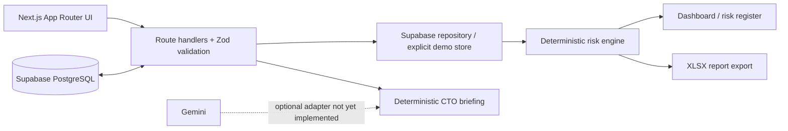

# ForgeOps AI

An educational, fictional hardware-programme control tower. It turns supply commitments, BOM demand, milestone dependencies, capacity, and document due dates into traceable operational risks. It is not an official MakersHive product and does not assert ISO 13485 compliance.

## Run locally

```bash
npm install
npm run dev
# another terminal
npm test
```

Copy `.env.example` to `.env.local`. For the explicitly non-persistent fictional demo, set `FORGEOPS_DEMO_MODE=true`; otherwise configure Supabase as described below. Open `http://localhost:3000`.

## Database setup (Supabase PostgreSQL)

The application uses Supabase only from server-side route handlers. Create a Supabase project, then set these values in `.env.local`:

```bash
NEXT_PUBLIC_SUPABASE_URL=https://your-project.supabase.co
SUPABASE_SERVICE_ROLE_KEY=server-only-service-role-key
FORGEOPS_DEMO_MODE=false
```

Apply [001_operational_repository.sql](/Users/gayatrigajam/ForgeOps%20Ai/supabase/migrations/001_operational_repository.sql) in the Supabase SQL Editor, followed by [001_fictional_demo.sql](/Users/gayatrigajam/ForgeOps%20Ai/supabase/seed/001_fictional_demo.sql). The seed is idempotent and date-relative. The service-role key must never be exposed to the browser, committed, or deployed as a `NEXT_PUBLIC_*` variable.

When either Supabase variable is set but the pair is incomplete, or the connection/query fails, ForgeOps returns an explicit error. It does not silently switch to the demo datastore. `FORGEOPS_DEMO_MODE=true` is intentionally opt-in and is not a deployment configuration.

## Demonstration walkthrough

1. Open **Supply Chain & BOM readiness**.
2. Change PO-1042 (MTR-042) to a date after the Bionic Prosthetic Hand assembly date.
3. The API validates the date, updates the commitment, and reruns the deterministic risk engine.
4. Open **Risk Intelligence** or the executive dashboard to see the material shortage, owner, required action, and linked PO/component evidence.
5. Download the Excel report or generate the deterministic fallback CTO briefing.

The scheduling model is finish-to-start dependencies. Cycles are rejected; downstream traversal identifies exposed successor milestones. BOM availability equals on-hand quantity plus only open PO quantities committed on or before the assembly date. In a production database, inventory reservations must be allocated transactionally by demand priority to prevent double-counting.

## Architecture



### Persistence boundary

When Supabase variables are configured, the application reads dashboard data and writes delivery commitments through a server-side Supabase repository. Purchase-order edits then survive process restart. Without Supabase, only explicit `FORGEOPS_DEMO_MODE=true` enables the seeded in-memory demonstration; its edits intentionally disappear at restart. Risk lifecycle persistence, authentication, and tenancy policies remain future work.

## What is included

- Four date-relative fictional programmes, 25 components, 8 suppliers, BOM demand, POs, milestones, capacity, and approval data.
- Deterministic shortage, capacity overload, regulatory deadline, and material-risk rules.
- Interactive supplier commitment update, risk register, dependency exposure, Excel export, and no-key fallback CTO briefing.
- A repeatable Supabase migration and idempotent date-relative fictional seed dataset.

## Screenshots

No screenshots are checked in because this workspace does not provide a browser capture facility. After starting the app, capture the Executive Overview, Supply Chain edit flow, and Risk Intelligence register into `screenshots/` before publishing a portfolio case study.

## Why ForgeOps AI Matters

Late discovery is expensive in hardware programmes: a supplier slip can strand inventory, block a build, and cascade into delivery commitments. ForgeOps makes those links visible early, with each escalation tied back to the exact commitment, component, BOM need, and milestone that caused it.

## Production follow-ons

Add Supabase authentication and organisation-level RLS policies, implement transactional reservation allocation and audited risk-resolution actions, then add Gemini only as a validated evidence summarizer. Add Playwright database integration coverage after credentials are available.
